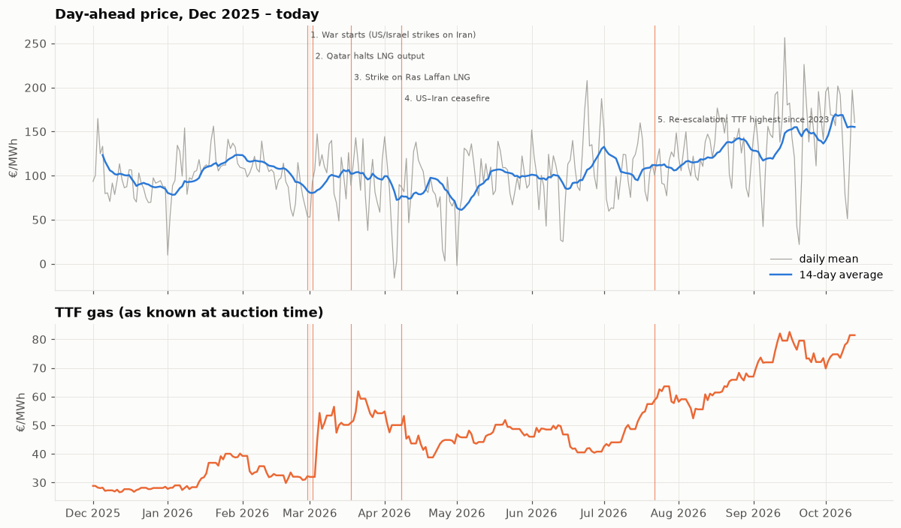
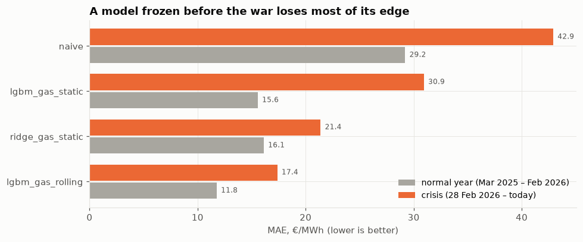

# Day-ahead electricity price forecasting under the 2026 Iran-war gas shock (Germany)

Forecasting hourly German (DE-LU) day-ahead power prices, and measuring what the war that began on
**28 February 2026** did to them and to forecasting models trained in "normal" times.

> **What happened.** On 28 Feb 2026 US/Israeli strikes on Iran started a war that closed the Strait of Hormuz
> (≈20 % of world LNG). Qatar halted LNG output on 2 Mar, a missile strike on Ras Laffan on 18 Mar took out 17 % of
> Qatar's LNG capacity, a ceasefire on 8 Apr did not restore shipping, and it collapsed on 8 Jul when US strikes resumed. Germany buys almost no Qatari LNG directly,
> but it buys gas at European (TTF) prices, and gas plants usually set the German power price.
> Event dates with news sources: [`src/events.py`](src/events.py).



## Key results

*All numbers as of **13 Oct 2026**.* Crisis window **28 Feb – 13 Oct 2026**, compared with **the same calendar window
of 2025** (to remove seasonality):

| | same window 2025 | crisis 2026 | change |
|---|---|---|---|
| Mean day-ahead price, €/MWh | 79.7 | 111.3 | **+40 %** |
| Hours above 150 €/MWh | 4.5 % | 26.9 % | ×6 |
| Mean daily spread (max − min), €/MWh | 146 | 182 | +25 % |
| TTF gas (as known at auction), €/MWh | 35.3 | 55.2 | +56 % |
| German gas storage fill | 49.6 % | 38.0 % | −12 pp |

* **Gas is the main driver of the increase, but its exact share is not robust.** A regression of daily price on TTF
  and residual load, fitted on 2023 – Feb 2026, attributes ~60 % of the +31.6 €/MWh to gas. Depending on the fitting
  window the gas pass-through ranges from 0.65 to 1.83 €/€, so the share ranges from ~40 % to all of it
  ([notebook](notebooks/01_eda.ipynb)). Whether a "crisis premium" exists on top of gas cannot be identified without
  a carbon price in the data.
* **Lower residual load** (−3.0 GW: solar +2.0 GW, wind +0.9 GW, demand −0.1 GW) pulled prices down by ~8 €/MWh.
* **The supply curve shifted up by 35–50 €/MWh** at the same residual load.
* **Evenings, not middays:** evening hours rose ~50 €/MWh, solar-noon hours ~9 €/MWh.

### Models: a model frozen before the war breaks

Walk-forward backtest, MAE in €/MWh, as of 13 Oct 2026 ([`reports/metrics.csv`](reports/metrics.csv)):

| Model | normal year (Mar 2025 – Feb 2026) | crisis (28 Feb 2026 –) |
|---|---|---|
| Naive (same hour last week) | 29.2 | 42.9 |
| LightGBM, trained once before the window | 13.7 | **31.0** (×2.3) |
| LightGBM + gas features, trained once | 15.6 | 30.9 |
| Linear + gas features, trained once | 16.1 | 21.4 |
| **LightGBM + gas features, retrained weekly** | **11.8** | **17.4** |



Having gas features is not enough on its own. Two things broke the frozen models:

* **Tree models cannot extrapolate.** Once TTF moved beyond the range seen in training, the static LightGBM kept
  forecasting pre-war prices. Its bias grew to +50 €/MWh by September ([figure](reports/figures/09_bias.png)).
* **The relationship itself shifted.** The static linear model can extrapolate, yet its bias also grew to about
  +25 €/MWh by October: prices rose by more than the pre-war gas coefficient implies.

Weekly retraining with gas features is significantly better than every other variant (Diebold–Mariano test on daily
losses, p < 0.01, [`reports/dm_test.csv`](reports/dm_test.csv)). The static LightGBM with and without gas features is
statistically the same in the crisis (p = 0.44). In the normal year gas features even *hurt* it (15.6 vs 13.7):
price lags already carry the gas level, and the tree used TTF as a proxy for season. TTF of 25–30 €/MWh came with
64 €/MWh power in training (mostly spring/summer 2024) but 95 €/MWh in the test year (winter 2025/26).

### What is a forecast worth? (1 MW / 1 MWh battery)

One charge/discharge cycle per day, hours chosen from the forecast, revenue settled at actual prices, 88 % round-trip
efficiency. Same calendar windows, as of 13 Oct 2026 ([notebook](notebooks/02_models.ipynb)):

| Model | € per day, 2025 window | € per day, crisis | capture, crisis |
|---|---|---|---|
| Perfect foresight | 126.1 | 155.7 | 100 % |
| Linear + gas, trained once | 122.1 | **153.7** | **98.7 %** |
| LightGBM + gas, retrained weekly (best MAE) | 122.1 | 152.0 | 97.6 % |
| LightGBM + gas, trained once | 121.2 | 152.0 | 97.6 % |
| Naive | 110.9 | 142.9 | 91.8 % |

**MAE is the wrong metric for this decision.** One cycle a day only needs the *shape* of the day (where the trough and
the peak are), not the price level:

* Any real model earns **~9–11 € per day more than the naive one** in the crisis, about **3.3–3.9 k€ per MW per year**
  (p < 0.001). This is the business value of forecasting here.
* Between real models the differences are small. Weekly retraining cut the LightGBM MAE from 30.9 to 17.4, but added
  only 0.06 € per day of revenue (13 € over 228 days, not significant). The frozen linear model earns the most
  (+1.7 € per day vs the best-MAE model, p = 0.005) despite a worse MAE.
* The crisis made flexibility more valuable: perfect-foresight revenue rose by **23 %**, because gas raised evening
  peaks much more than midday prices.

## Data

Only real, observed data is used. **No third-party price forecasts** (exchange, vendor or website "predictions") are
used anywhere. The model inputs are the same information a trader has at auction time.

| Source | Series | Used as |
|---|---|---|
| [ENTSO-E Transparency](https://transparency.entsoe.eu) | day-ahead prices DE-LU | target, price lags |
| ENTSO-E | TSO day-ahead load, wind & solar forecasts | features |
| ENTSO-E | actual load | analysis only |
| [AGSI+](https://agsi.gie.eu) | German gas storage | feature (lag 3 days) |
| Yahoo Finance (unofficial) | TTF front-month; KRBN as a rough CO₂ proxy | features (lag 2 days) |
| [Open-Meteo](https://open-meteo.com) archive | actual weather | analysis only |

## Approach: no look-ahead

The day-ahead auction for day D closes at **12:00 CET on D-1**. Every feature must be known by then:

* price lags are taken by (delivery day, local hour), so the latest is day D-1, which is fully known. DST days are handled;
* TTF/CO₂ use the close of **D-2** (D-1's close comes after the auction);
* AGSI storage uses gas day **D-3** (published the evening after the gas day);
* actual load and actual weather are never model inputs.

These rules are enforced by tests: [`tests/test_leakage.py`](tests/test_leakage.py).
In the backtest every day is forecast only from rows with delivery day < D.

## Reproduce

```bash
python -m venv .venv && .venv\Scripts\activate     # Windows
pip install -r requirements.txt
cp .env.example .env                               # add ENTSOE_API_KEY and AGSI_API_KEY

python -m src.fetch_entsoe          # ~20 min first time, cached per month afterwards
python -m src.fetch_weather
python -m src.fetch_gas_storage
python -m src.check_market_tickers
python -m src.build_dataset         # → data/processed/dataset.parquet
python -m pytest -q                 # leakage tests
python -m src.backtest              # → reports/metrics.csv (~4 min)
python -m src.battery               # → reports/battery.csv
python -m src.dm_test               # → reports/dm_test.csv (Diebold–Mariano)
```

Notebooks: [`01_eda.ipynb`](notebooks/01_eda.ipynb) (what the war changed) and
[`02_models.ipynb`](notebooks/02_models.ipynb) (models, bias, battery).

## Limitations

* **No EU carbon (EUA) price.** KRBN is a global carbon ETF, only a rough proxy. Part of the "unexplained" crisis premium is probably carbon.
* **TTF from Yahoo Finance** is unofficial (96 % business-day coverage checked in `check_market_tickers`).
* **TSO wind/solar forecasts**: ENTSO-E allows publication up to 18:00 on D-1, i.e. possibly after the auction.
  Using them is standard practice in the price-forecasting literature, but strictly it is a slightly optimistic assumption.
* Since 1 Oct 2025 the auction clears in 15-minute products. Everything here is hourly averages.
* The crisis window is 7.5 months of one market; significance tests treat it as one sample. The battery model is simple: one cycle per day, price-taker, no degradation.

## Structure

```
src/
  config.py               zone, dates, publication lags
  events.py               2026 war timeline (annotation only)
  fetch_*.py              data download (ENTSO-E, Open-Meteo, AGSI+, Yahoo)
  build_dataset.py        hourly table with leakage-safe daily joins
  features.py             model features
  backtest.py             walk-forward backtest, static vs rolling
  battery.py              battery arbitrage value of a forecast
  dm_test.py              Diebold–Mariano significance tests
  plots.py                chart style
tests/test_leakage.py     no-look-ahead tests
notebooks/                EDA and models
reports/                  metrics, battery results, figures
docs/WORKFLOW_ru.md       working notes (Russian)
```
